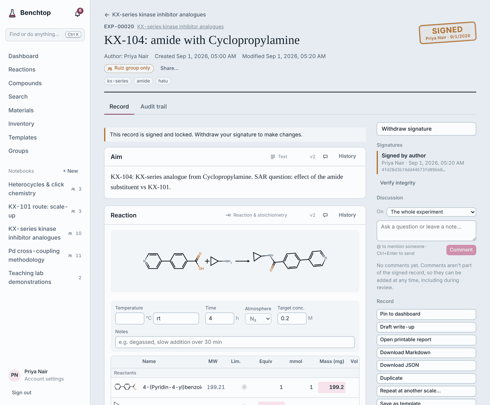
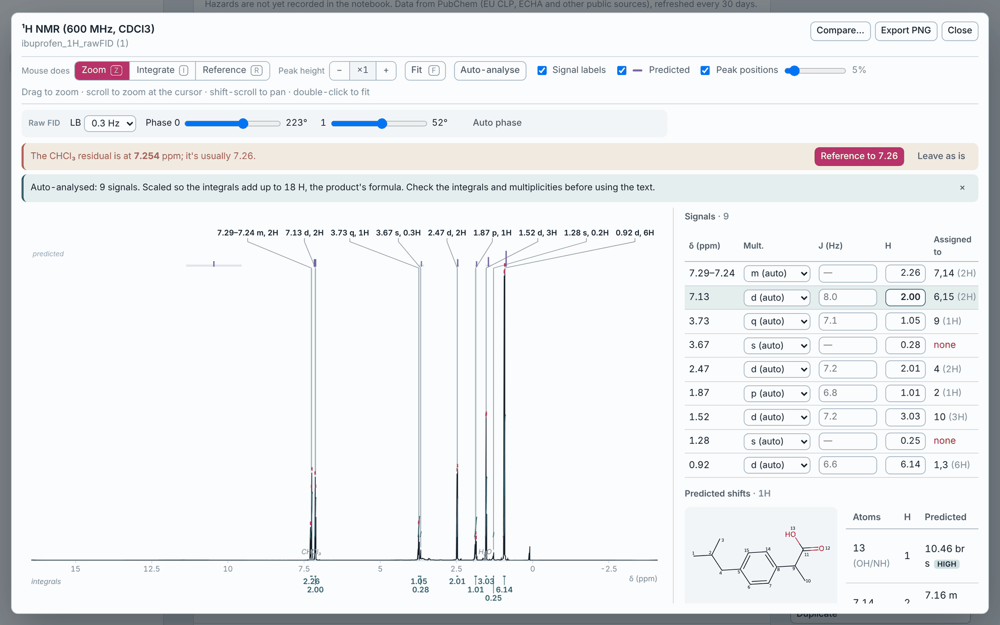
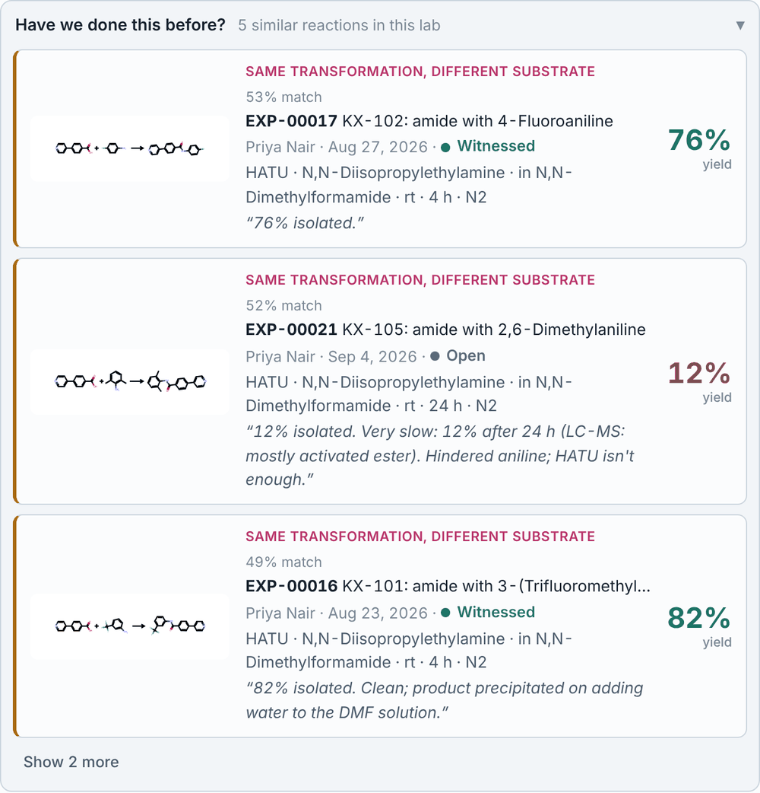
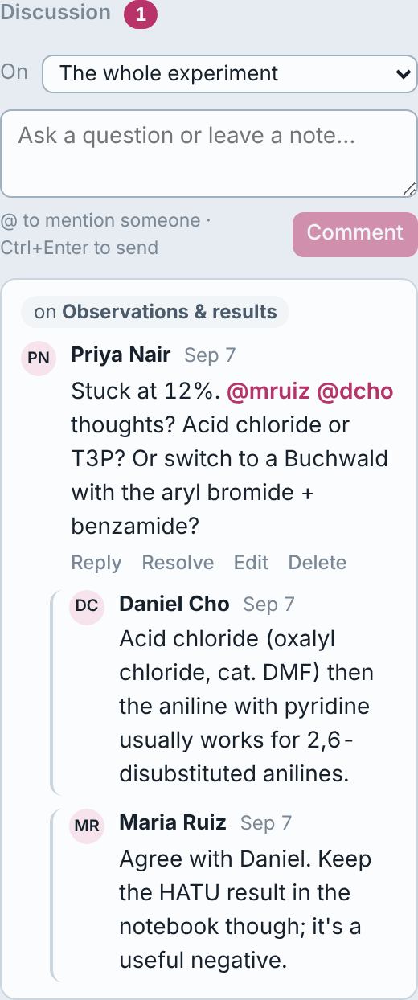
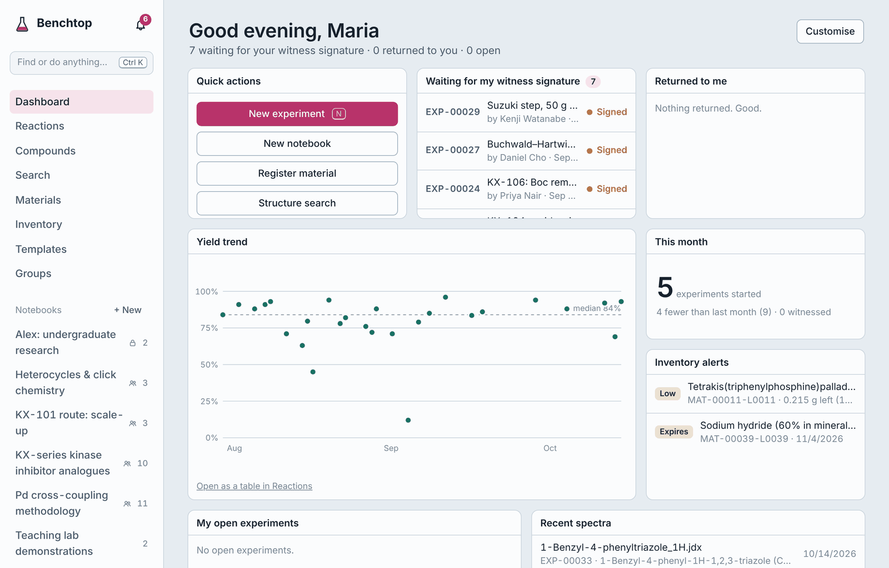
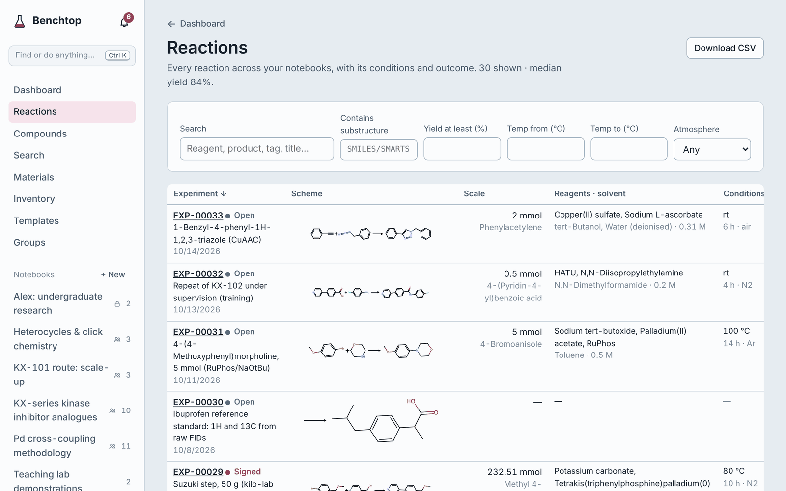
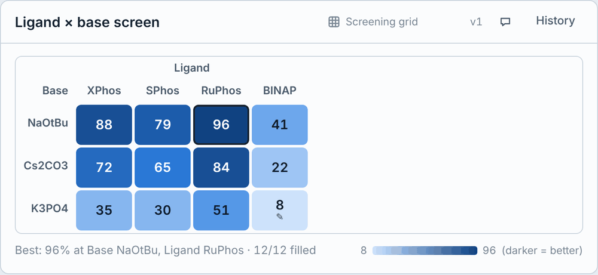
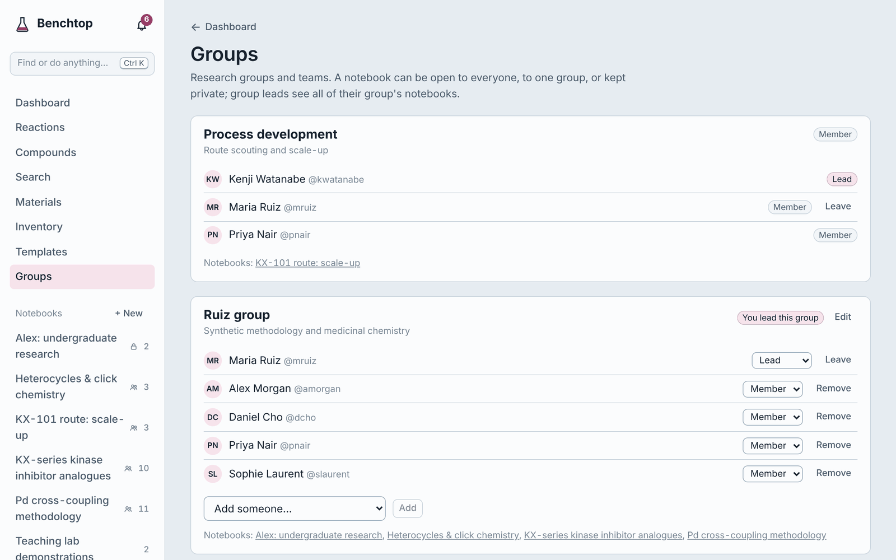
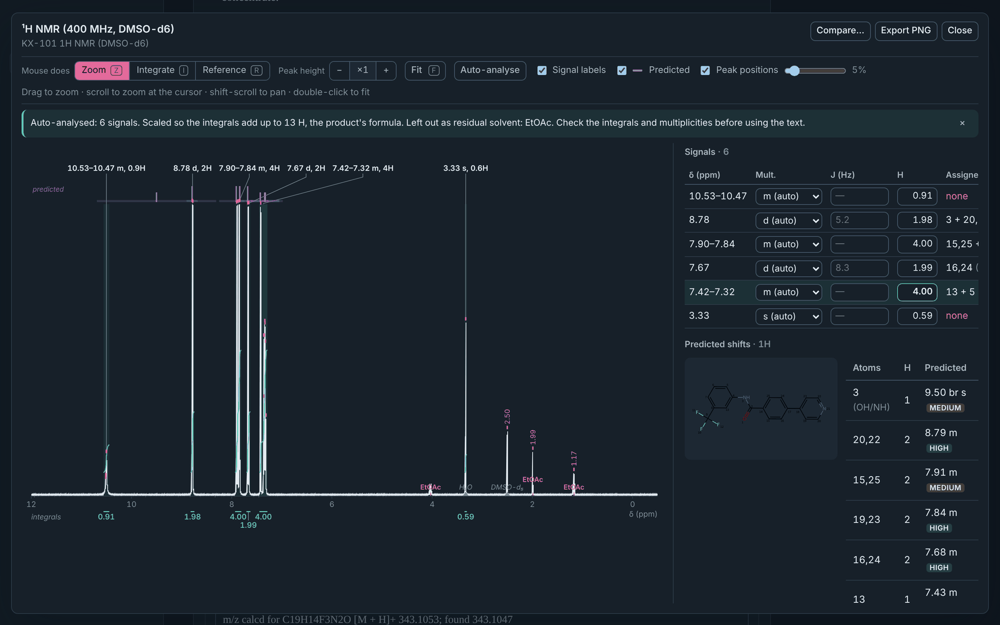

# Benchtop ELN

An open-source, self-hosted electronic lab notebook for synthetic chemistry. It covers the core
workflow of commercial chemistry ELNs such as Revvity Signals Notebook: notebooks of
experiments, a structure-aware stoichiometry table, a materials registry with lot-level
inventory, and an author/witness e-signature workflow backed by a tamper-evident audit trail.

This is a clean-room implementation built from publicly documented ELN concepts. It contains
no code, assets or data formats from any proprietary product and is not affiliated with Revvity.



## A look around

All screenshots come from the built-in demo lab (`./benchtop demo`): a fictional research group and
three months of their work. Nothing in them is real data.

**Spectra.** A raw Bruker FID of ibuprofen, phased and processed in the browser, auto-integrated and
assigned against predicted shifts (atom numbers match the structure):



<table>
<tr>
<td width="62%"><br>
<b>Have we done this before?</b> Similar reactions the lab has already run, with conditions, yields and
notes, under every reaction table, including the failures.</td>
<td width="38%" align="center"><br>
<b>Discussion.</b> Threads on any section, with @mentions and notifications, even on signed records.</td>
</tr>
<tr>
<td colspan="2"><br>
<b>Dashboard.</b> What's waiting for your signature, the lab's yields over time, low or expiring stock and
recent spectra. Everyone arranges their own.</td>
</tr>
<tr>
<td><br>
<b>Reactions overview.</b> Every reaction you can see, filterable by substructure, yield, temperature and
atmosphere, and exportable as CSV.</td>
<td><br>
<b>Screening grids.</b> Two-factor screens as a heatmap with the best conditions picked out.</td>
</tr>
<tr>
<td colspan="2"><br>
<b>Groups.</b> Research groups with leads; each notebook is open to everyone, to one group, or kept private.</td>
</tr>
</table>

**Impurity checks, in dark mode.** Residual solvents are recognised and quantified (here 3.6 mol% EtOAc)
and kept out of the integrals:



## What it does

| Area | Features |
|---|---|
| **Notebooks & experiments** | Notebooks hold experiments (`EXP-00042`). Each experiment is a stack of sections (add one from the *Add section* menu at the top, between any two sections, or at the end): rich text (sub/superscript, tables, chemistry symbols), reaction, data table, files. Tags, templates, duplicate, printable report and JSON export. |
| **Chemistry** | Draw structures and reactions in [Ketcher](https://github.com/epam/ketcher) (runs fully in the browser via WebAssembly). Drawing a reaction fills the stoichiometry table automatically, keeping counter-ions together (NaBH₄ stays one row). RDKit computes MW, formula, InChIKey and depictions server-side. |
| **Conditions** | Temperature (or rt/reflux), time, atmosphere and target concentration as real fields. Tick *fill to target M* on a solvent and its volume is calculated for you. |
| **Stoichiometry** | Enter mass, volume, mmol or equivalents in any row; the rest is calculated from the limiting reagent, accounting for purity, density (neat liquids) and molarity (solutions). Products get theoretical mass and % yield. The cell you typed is highlighted so you always know what's input vs. calculated. |
| **Work-up & characterisation** | Purification sections (method, stationary phase, eluent, Rf, isolated mass, appearance) and characterisation sections (¹H/¹³C NMR, HRMS, IR, mp, Rf, HPLC…), each item linkable to its data file. |
| **Spectra** | Drag spectrum files onto an experiment: JCAMP-DX (incl. compressed SQZ/DIF/DUP), zipped Bruker experiments (processed `pdata/*/1r`, or just the raw `fid`) and two-column CSV become characterisation items with technique, frequency and solvent filled in, and open already analysed. ¹H auto-analysis finds the signals, cuts out solvent/water/TMS lines (where they actually are), and scales integrals to the product formula's proton count; ¹³C gets a signal-to-noise peak list without the solvent. A note offers one-click referencing when the solvent residual is off. Viewing is inline or full-screen. Scroll to zoom at the cursor, shift-scroll to pan, live δ/Hz readout. Integrate by dragging: running integral curves are drawn over the peaks with values under the axis. Each ¹H signal is classified (s, d, t, q, p, dd, dt, td, m) with J in Hz, and you can override any multiplicity or J in the signals table. Type a proton count in any row to make it the reference. Click a peak to reference the axis (solvent residuals for CDCl₃, DMSO-d₆, CD₃OD, C₆D₆, D₂O, CD₂Cl₂, acetone-d₆, CD₃CN are marked and offered as one-click references). Integrated ¹H signals are labelled above the spectrum ("7.42 t, 2H") with leader lines to each multiplet, and integral values below the axis never overlap. Export a clean PNG for SI or slides. Everything is saved with the record. |
| **Raw FID processing** | Zip a Bruker experiment folder straight off the spectrometer, without processing it in TopSpin, and drop it in: Benchtop does the Fourier transform in your browser (exponential line broadening, zero filling, digital-filter group-delay removal, automatic phasing by entropy minimisation and polynomial baseline correction). Phase 0/1 sliders, an *Auto phase* button and a line-broadening choice are there if you want to adjust it; your settings are saved with the record. Checked against TopSpin on ibuprofen (¹H spectra correlate at 0.99; ¹³C peaks agree within 0.01 ppm). 1D only. |
| **Predicted NMR shifts** | When an experiment has a drawn product, its ¹H and ¹³C spectra show predicted shifts from [NMRShiftDB2](https://nmrshiftdb.nmr.uni-koeln.de), an open database of assigned spectra, as a purple lane above the spectrum. Each observed signal gets an *Assigned to* column (atom numbers match a numbered structure), and a panel lists every predicted group with its confidence and the observed shift it matched, flagging groups with no signal and signals no group explains. Prediction looks up each atom's surroundings out to four bonds (HOSE-style) in a table of 43,213 assigned structures (359,155 ¹³C and 125,904 ¹H shifts) that ships with Benchtop, and falls back to smaller spheres when a surrounding hasn't been seen. On structures held out of the table: median error 1.1 ppm for ¹³C and 0.12 ppm for ¹H; for "high" confidence atoms (about 45 %) 0.5 ppm and 0.07 ppm. Auto-analysis also uses the prediction so a product's own signals aren't mistaken for residual solvent. Benchtop checks for a newer NMRShiftDB2 export every 30 days and rebuilds the table on your computer when there is one (Admin → *Update now*, or `./benchtop update-nmr-data`). Diastereotopic protons and second-order effects aren't modelled; it's a check, not a substitute for assigning. |
| **Spectrum checks** | Auto-analysis flags residual lab solvents (EtOAc, hexane, acetone, DCM, Et₂O, THF, MeOH, toluene, DMF, Et₃N, silicone grease and more, from the Fulmer 2010 tables for CDCl₃, DMSO-d₆ and CD₃OD) only when every one of their signals is present, and reports each as mol% and wt% with an overall purity estimate. A checks panel compares the spectrum with the drawn product: total ¹H integral vs. the formula (allowing for exchangeable OH/NH), number of signals vs. symmetry-distinct H environments, ¹³C peaks vs. unique carbons, and warns when a minor set of signals looks like a second compound. *Compare* overlays up to four other spectra (starting material, crude, a reference), stacked or overlaid, and the overlay is saved with the record. |
| **HRMS helper** | On HRMS/MS items, pick the adduct ([M+H]⁺, [M+Na]⁺, [M+K]⁺, [M+NH₄]⁺, M⁺, [M−H]⁻), get the calculated m/z from the product structure (monoisotopic, electron mass corrected), type the found value and see the error in ppm; *Use* writes the standard `calcd for … ; found …` line. |
| **Dashboard** | The home page is a grid of widgets you arrange yourself: work lists (waiting for my witness signature, returned to me with the reason, my open experiments, recently edited, pinned), quick actions, sticky notes and section headings, a yield-over-time chart (click a point to open the experiment), this month's activity, recent spectra, and inventory alerts (lots below 20 % of what was received, or expiring within 30 days). *Customise* lets you drag, resize, add and remove widgets; the layout is saved to your account. Pin any experiment from its page. On a phone the widgets stack in one column. |
| **Write-up drafts** | *Draft write-up* composes an SI-style experimental paragraph from the reaction table, conditions, work-up and characterisation (amounts with sensible significant figures, mol% for catalysts, yield). It never guesses: anything missing is listed instead. Copy as rich text or add it as a section. |
| **Obsidian export** | Every experiment as a Markdown note with Dataview-ready front matter (status, product, yield, temperature, time…), the scheme as SVG, tables and attachments. `./benchtop export-obsidian <folder>` or set `BENCHTOP_OBSIDIAN_DIR` to sync hourly; an index note includes a ready-made Dataview table. |
| **Have we done this before?** | Under every reaction table, the most similar reactions anyone in the lab has already run (that you're allowed to see), as you draw it, even before there's a product. Reactions are compared by starting materials and products, by the transformation itself (which structural features appear and disappear) and by reagents and solvents, and labelled *same reaction*, *same transformation on a different substrate*, *same product* or *similar starting materials*. Each shows the scheme, who ran it and when, the conditions, the yield and the observations; *Use these conditions* copies the reagents, catalysts, solvents (as equivalents, so they scale) and conditions into your table. |
| **Reactions overview** | Every reaction across notebooks in one table: scheme, scale, reagents, conditions, yield, purification, data recorded. Filter by text, substructure, yield and temperature; sort; download CSV. |
| **Safety data (GHS)** | Hazard classifications come from PubChem's public API, which gathers them from the EU CLP harmonised classification (Annex VI), the ECHA C&L Inventory (with the share of notifiers behind each statement), Japan's NITE, Safe Work Australia and HSDB. Benchtop uses the most authoritative source for each chemical (harmonised, then the largest ECHA aggregate) and still lists anything other sources add. Every record shows its source and when it was fetched. Data older than 30 days is re-checked automatically while Benchtop runs. If a classification changes (say a new H350), the change goes into the audit log and onto your dashboard until someone marks it reviewed. Offline, the last data is kept and its age shown. Special hazards (pyrophoric, water-reactive, peroxide former, oxidiser, CMR, acid-gas, explosive) are flagged from the official codes. Supplier SDSs still take precedence. |
| **Risk assessment** | New experiments include a *Safety & risk assessment* section that reads the reaction table and shows every chemical's pictograms, signal word and H-statements, plus warnings for known dangerous combinations (azides with CH₂Cl₂, NaH in DMF/DMSO, water-reactive reagents with water or alcohols, oxidisers with flammables) and controls suggested from the P-statements. *Record hazards in notebook* saves a snapshot into the record (so a signed record keeps what was known at signing), and a banner appears if the reaction or the classifications change afterwards. |
| **Reagent lookup** | Type a name, CAS number or SMILES to fill in a new material (structure, MW, CAS, density, hazards) from PubChem, or to add a compound to a reaction straight from *Add from registry* without registering it first. |
| **Green metrics** | Atom economy, reaction mass efficiency, E-factor, PMI and solvent L/kg under every reaction table and in the Reactions overview (reaction only; work-up and purification aren't counted). |
| **Scale-up** | *Repeat at another scale* creates a new experiment at ×N (or a target mmol of the limiting reagent): typed amounts scale, equivalents don't, fill-to-concentration solvents recalculate, results and the risk assessment start fresh. |
| **Screening grids** | A two-factor screening section (e.g. base × temperature) with a heatmap of yields or any other response, best result highlighted, and each cell optionally linked to the experiment that produced it. |
| **Compounds** | Every product and registered sample with cLogP, TPSA, HBD/HBA, rotatable bonds, Fsp³, QED and Lipinski/Veber flags (RDKit, on the parent structure), sortable, with a drug-like filter. |
| **Materials & inventory** | Structure-deduplicated registry (`MAT-00007`) with CAS, density, hazards. Lots/containers with barcode, location, supplier, purity. Every withdrawal is a ledger entry with unit conversion (g ↔ mL via density). One click deducts a reaction's reagents from their lots (after showing exactly what will be taken), and each deduction can be undone; one click registers an isolated product as a new material + lot linked back to the experiment. |
| **Search** | Results as you type. Every word must match, in any order, anywhere in an experiment: title, tags, ID, notebook, author, section text, reagent names, conditions ("80" finds 80 °C, not 0.9808), table values and file names; "quoted phrases" match exactly. Matches are highlighted with the section they came from. Filter by status, notebook or your own experiments; separate tabs for experiments, materials (incl. CAS and lot barcodes) and files. **Substructure** search highlights the matching atoms on every structure; **similarity** search shows a score bar with a live threshold slider. Recent searches, keyboard navigation (↓ into results, Enter to open) and shareable URLs. |
| **Signing** | Author signs → record locks → a different user witnesses (or returns it with a reason). Signing requires password re-entry. Each signature stores a SHA-256 hash of the full record (all sections + attachment hashes); *Verify integrity* recomputes it and flags out-of-band edits. Records can be voided, never deleted. |
| **History & audit** | Every section save is a new version (view any past version). Every mutation, login and failed signature attempt is written to an append-only audit log where each event hashes the previous one; *Verify hash chain* detects any altered, removed or reordered event. Attachments are content-addressed and checked against their hash on download. |
| **Quick navigation** | ⌘K (Ctrl K) finds any experiment, material (by name or CAS), notebook or page, and runs actions such as "New experiment"; press N anywhere for a new experiment. Amount fields accept units: `1.2 g` in a mg cell, `250 µL` in mL, `0.5 mol`, `30 min`, `500 mM`. |
| **Groups & sharing** | Research groups with leads (a PI, a manager) and members. Each notebook is open to everyone, to one group, or private (plus its group's leads, who see all of their group's notebooks). Share a single experiment with anyone, to view or to edit; only the author signs. Records someone can't open don't appear anywhere for them: lists, search, reactions, compounds, dashboard, spectra and similar-reaction suggestions all respect it. Existing notebooks stay open to everyone until you change them. |
| **Comments & notifications** | Discuss any experiment or a single section in threads: ask about a peak, request a change, approve. @mention people (autocomplete as you type) and they're notified; replies and comments on your experiments notify you too, via the bell. Resolve threads when done. Comments can be added during review and after signing because they aren't part of the signed record (the signed hash doesn't change), and every comment, edit, deletion and resolution is in the audit trail. Mention someone who can't open the record and Benchtop offers to share it with them. |
| **Users & accounts** | Admin, scientist and read-only viewer roles. A fresh install opens on a setup screen where you create your own administrator account (the built-in admin login is then retired). **Single sign-on** with Microsoft 365 / Entra ID, Google Workspace or any OpenID Connect provider: people sign in with their university or company account, optionally limited to your email domains, with accounts created on first sign-in or matched to ones an admin added. Sign-ins can last 30 days. Everyone has an account page to change their name, email, username and password, and preferences (light/dark theme, default notebook, open spectra full-screen) that follow them between computers. Signatures store the printed name at the moment of signing, so later name changes never alter signed records. Admins can edit any account. |

## Quick start (Mac)

Double-click **Benchtop.command** in the folder, or run:

```bash
./benchtop            # first run sets everything up, then opens your browser
```

Benchtop runs while that Terminal window is open; close it (or press Ctrl+C) to stop. On a fresh install it
asks you to create your own account (you become the administrator) and can add a demo notebook. If macOS
says Benchtop.command can't be opened because it was downloaded, right-click it and choose *Open* once.
Needs Python 3.11+ (python.org); Node is only needed if the bundled interface has to be rebuilt.

```bash
./benchtop status               # running? which version? where is the data?
./benchtop lab                  # share it with labmates on the same network
./benchtop upgrade NEW.zip      # backs up, swaps in the new version, keeps your data
./benchtop backup | backups | restore FILE
./benchtop seed                 # demo data
./benchtop export-obsidian ~/Documents/Vault/Benchtop
./benchtop update-nmr-data      # rebuild the NMR shift table from the latest NMRShiftDB2 export
./benchtop update-nmr-data FILE.sd   # …or from a nmrshiftdb2withsignals.sd you downloaded
```

Backups are automatic: one on start-up if the newest is more than a day old, then daily while running,
keeping the newest 14. Each is a single zip with a consistent database snapshot and every attachment.
Set `BENCHTOP_BACKUP_DIR` to a folder in iCloud Drive or Dropbox to keep copies off your Mac.

**Want to explore with realistic data first?** `./benchtop demo` opens a demo lab on
http://localhost:8001, kept completely apart from your own notebook: the fictional Ruiz group
(a PI, a postdoc, PhD students, an undergraduate, a process chemist, a lab manager and a read-only
collaborator) and three months of their work. It includes a Suzuki substrate scope, base × solvent and
ligand × base screens, the KX-101 med-chem series (Suzuki, hydrolysis, HATU amides incl. a failed hindered
aniline, Boc chemistry, reductive amination), a 1 g → 10 g → 50 g process scale-up with IPC data and Pd
levels, NaH/DMF and azide safety cases, CuAAC, teaching-lab preps, and an ibuprofen reference with real raw
FIDs. Records are witnessed, signed, returned and voided; there are comment threads, shares, inventory use and
spectra to analyse. The sign-in page lists everyone; click a name to see Benchtop as them.
`./benchtop demo --reset` rebuilds it.

**Using it as a group?** See [docs/SERVER.md](docs/SERVER.md): a lab Mac on the local network
(`./benchtop lab`), the same over Tailscale from anywhere, or a server with HTTPS, Postgres and single
sign-on (`deploy/`).

## Quick start (Docker)

```bash
docker compose up -d --build
docker compose exec app python -m app.seed   # optional demo data
open http://localhost:8000
```

Sign in as `admin` with the password in `BENCHTOP_ADMIN_PASSWORD` (default in compose: `change-me-now`).
The demo seed adds **alice** (author) and **bob** (witness), both `benchtop123`, a reagent
registry with lots, a template and a worked Suzuki coupling.

For a shared server, run Postgres instead of SQLite: `docker compose --profile postgres up -d`
and set `BENCHTOP_DATABASE_URL` as shown in `docker-compose.yml`. Put it behind HTTPS (Caddy,
nginx, Tailscale) before anyone uses it over a network.

## Development

```bash
# API (Python 3.11+)
cd backend
pip install -r requirements.txt pytest
python -m app.seed                       # creates ./data with demo content
uvicorn app.main:app --reload            # http://localhost:8000/docs for the OpenAPI explorer
pytest -q

# Web app (Node 20+)
cd frontend
npm install
npm run dev                              # http://localhost:5173, proxies /api to :8000
```

To serve the built app from the API (what the Docker image does):
`npm run build`, then start uvicorn with `BENCHTOP_STATIC_DIR=../frontend/dist`.

### Configuration

| Variable | Default | |
|---|---|---|
| `BENCHTOP_DATA_DIR` | `./data` | SQLite file, attachments, generated secret key |
| `BENCHTOP_DATABASE_URL` | SQLite in data dir | Any SQLAlchemy URL, e.g. `postgresql+psycopg://…` |
| `BENCHTOP_SECRET_KEY` | generated, stored in data dir | Signs session tokens |
| `BENCHTOP_ADMIN_USER` / `_PASSWORD` | `admin` / `admin` | First account, created only when the user table is empty |
| `BENCHTOP_TOKEN_TTL_HOURS` | `12` | Session length |
| `BENCHTOP_MAX_UPLOAD_MB` | `50` | Attachment size limit |
| `BENCHTOP_STATIC_DIR` | unset | Serve the built frontend from this directory |
| `BENCHTOP_BACKUP_DIR` | `<data dir>/backups` | Where backups are written |
| `BENCHTOP_BACKUP_KEEP` | `14` | Number of backups kept |
| `BENCHTOP_BACKUP_INTERVAL_HOURS` | `24` | `0` turns automatic backups off |
| `BENCHTOP_PORT` | `8000` | Port used by `./benchtop` |
| `BENCHTOP_OBSIDIAN_DIR` | unset | Vault folder to sync Markdown notes into every hour |
| `BENCHTOP_PUBCHEM` | `on` | `off` stops all PubChem lookups (works fully offline with whatever was fetched before) |
| `BENCHTOP_SAFETY_REFRESH_DAYS` | `30` | Safety data older than this is re-checked by the hourly housekeeping |
| `BENCHTOP_NMR_AUTO_UPDATE` | `on` | `off` stops the monthly check for a newer NMRShiftDB2 export (the bundled table is still used) |
| `BENCHTOP_OIDC_ISSUER` / `_CLIENT_ID` / `_CLIENT_SECRET` | unset | Single sign-on with any OpenID Connect provider (see docs/SERVER.md) |
| `BENCHTOP_OIDC_NAME` | from the issuer | Sign-in button label, e.g. `Microsoft`, `UTORid` |
| `BENCHTOP_OIDC_ALLOWED_DOMAINS` | any | Comma-separated email domains allowed to sign in |
| `BENCHTOP_OIDC_AUTO_CREATE` | `on` | `off`: only people an admin added (matched by email) can sign in |
| `BENCHTOP_PASSWORD_LOGIN` | `on` | `off`: single sign-on only (admins keep password sign-in as a fallback) |
| `BENCHTOP_PUBLIC_URL` | from the request | The address people use, for sign-on redirects behind a proxy |

The `./benchtop` launcher also reads `KEY=value` lines from `backend/data/settings.env`, which upgrades never touch.

## Architecture

```
frontend/  React 18 + TypeScript + Vite
  pages/            Home, Notebook, Experiment, Materials, Inventory, Search, Templates, Admin
  components/       EntryCard (autosave + optimistic concurrency), ReactionEntry (stoichiometry grid),
                    ConditionsBar, PurificationEntry, CharacterizationEntry, SpectrumViewer (canvas),
                    TextEntry (TipTap), StructureEditor (Ketcher, lazy-loaded), SignDialog, …
  spectra.ts        JCAMP-DX / CSV / Bruker reader, peak picking, integration, auto-analysis
  fid.ts            raw FID processing: apodisation, FFT, group delay, auto-phase, baseline
backend/   FastAPI + SQLModel + RDKit
  app/models.py     Notebook, Experiment, Entry, EntryVersion, Attachment, Signature,
                    Material, Lot, LotTransaction, AuditEvent, User
  app/chem.py       structure parsing, depiction, reaction → rows, stoichiometry engine, search
  app/audit.py      hash-chained audit log + verifier
  app/backup.py     snapshot/zip backups, pruning, restore (also a CLI)
  app/writeup.py    SI-style experimental paragraph composer
  app/export_md.py  Markdown/Obsidian export and vault sync (also a CLI)
  app/nmrpredict.py NMR shift prediction: atom environments, table builder, lookup
  app/nmrdata.py    NMRShiftDB2 download and rebuild (also a CLI)
  app/data/         bundled NMR shift table and its licence
  app/access.py     who can see and edit what (groups, notebook visibility, shares), used by every route
  app/routers/      auth, sso, experiments (+signing, export), groups (+sharing), comments (+notifications),
                    materials, chemistry, search, reactions (+similar), admin
  tests/            API tests incl. signature tamper detection and audit-chain tamper detection
```

Design notes:

- **The server is the source of truth for calculations.** The grid posts rows to
  `/api/chem/stoichiometry` as you type and every saved reaction section is recomputed on save,
  so stored numbers can't drift from what the engine would produce.
- **Saves are versioned and conflict-checked.** Each section save sends the version it was based
  on; a stale save returns 409 instead of silently overwriting a colleague's edit.
- **Upgrades are in place.** On start-up, columns added by newer versions are added to an existing database automatically (always nullable, so existing rows are untouched).
- **Nothing is hard-deleted.** Sections are soft-deleted with a final version; lots go to
  `empty`/`disposed`; experiments are voided.

## API

Everything the UI does is available over REST with a bearer token; interactive docs at `/docs`.

```bash
TOKEN=$(curl -s localhost:8000/api/auth/login -H 'content-type: application/json' \
  -d '{"username":"alice","password":"benchtop123"}' | jq -r .token)
curl -s localhost:8000/api/search -G -d q='c1ccccc1Br' -d mode=substructure -H "Authorization: Bearer $TOKEN"
```

## Security

- **Passwords** are hashed with PBKDF2-HMAC-SHA256 at 600,000 iterations (OWASP's recommendation) with a random salt; older hashes are upgraded silently at the next sign-in. New passwords follow NIST SP 800-63B: at least 10 characters, not among the 10,000 most common passwords (or one with a digit tacked on), not built from your username, name or email, and no forced symbol rules or expiry. You get live feedback while typing.
- **Guessing is throttled**: 5 wrong passwords for an account (or 30 from one network address) in 15 minutes pause sign-in for that account; the same applies to password re-entry when signing records and when changing your username or password. Failed attempts are in the audit trail, and a wrong username takes as long to reject as a wrong password, so accounts can't be discovered by timing.
- **Sessions live on the server**: Account settings lists every browser you're signed in on and can sign any of them out. Signing out really ends the session, changing your password signs out all your other devices, and admins can sign a person out everywhere (a lost laptop) or deactivate them, which ends their sessions immediately.
- **Admin-set passwords are temporary**: accounts an admin creates, or whose password an admin resets, must choose their own password at the next sign-in.
- **First-run safety**: until setup is done, the built-in admin/admin login can't be used, and setup can only be completed from the computer Benchtop runs on, so nobody else on a shared network can claim the admin account.
- **Browser protections**: a Content Security Policy (only Benchtop's own scripts run; pages can't be framed by other sites), `nosniff`, no referrer leaks, and API responses that aren't cached.
- Report security problems privately as described in [SECURITY.md](SECURITY.md).

## Regulatory note

Benchtop implements technical controls that 21 CFR Part 11 / EU Annex 11 expect (unique
accounts, password-backed e-signatures with meaning and timestamp, record locking, version
history, append-only audit trail with tamper evidence). Software alone is not compliance: a
regulated deployment still needs validation (IQ/OQ/PQ), SOPs, access reviews, backups and
time-source controls owned by your organisation. Treat this as a research ELN unless you do
that work.

## Roadmap ideas

- Next: compound and batch registration with a route view, `.eln` import/export (ELN Consortium format), bench mode with phone photos and barcode scanning; HPLC/LC-MS traces, PDF export, DOI references

- Plate/sample-set entities and a sample-tracking view
- Varian/JEOL raw FIDs, 2D NMR, and mzML for MS
- Instrument file drop-folders that auto-attach to experiments
- Email notifications and witness assignment
- PDF/A export with embedded signature manifest

## Licence

Apache-2.0. Bundles Ketcher (Apache-2.0, EPAM) and uses RDKit (BSD-3-Clause).

The NMR shift table in `backend/app/data/` is derived from NMRShiftDB2 and is distributed under the
nmrshiftdb2 data licence (attribution, share-alike; see `backend/app/data/NMRSHIFTDB2_LICENSE.md`).
Please cite S. Kuhn and N. E. Schlörer, *Magn. Reson. Chem.* 2015, 53, 582–589 if you use the
predictions in published work. The ibuprofen raw FIDs in `samples/` come from
cheminfo/bruker-data-test (MIT).
